<div align="center">
  
</div>

<br>

### Hi, I’m Rob 👋 — Principal Engineer & Fractional CTO

Building resilient products and high-trust teams across backend, mobile, web, cloud, and applied AI. Mostly looking for **Tech for Good** and mission-driven problems worth solving.

## 😀 ☀️ 🎉

```kotlin
sealed interface Craft {

    sealed interface Engineering : Craft {
        data class Mobile(
            val native: Set<String> = setOf("Swift", "Kotlin"),
            val crossPlatform: Set<String> = setOf("Kotlin Multiplatform", "Flutter")
        ) : Engineering

        data class BackendAndCloud(
            val languages: Set<String> = setOf("Kotlin", "TypeScript", "Go", "Python"),
            val infra: Set<String> = setOf("AWS", "GCP")
        ) : Engineering

        data class AppliedAI(
            val systems: Set<String> = setOf("Agentic Frameworks", "Self-Healing Prompts", "Code Guardrails")
        ) : Engineering
    }

    sealed interface Leadership : Craft {
        data object FractionalCTO : Leadership
        data object TechnicalTurnarounds : Leadership
        data object HighTrustTeams : Leadership
        data object RegulatedDelivery : Leadership
    }
}
```

## 🌱 📖 ✨

```kotlin
fun main() {
    val capabilities = Craft::class.sealedSubclasses

    while (curious) {
        build(mission = "Tech for Good", using = capabilities)
        refactor(buySpaceForTheFuture = true, psychologicalSafety = true)
    }
}
```

<details>
<summary><b>🛠️ Selected War Stories & Engineering Craft (Click to expand)</b></summary>
<br>

- **0-to-1 AI Fitness App:** Co-founded and shipped a personalised workout app across iOS, Android, and web (15k month-one downloads) powered by Flutter, Go on Cloud Run, and a self-healing multi-shot AI agent system.
- **Zero-Regression Migrations:** Built a custom golden-master contract-testing framework to record live PHP payloads and verify 100% API parity against a rewritten serverless Go backend.
- **Headless Flutter UI Testing:** Decoupled Flutter rendering via a sealed-class finite state machine for fast, deterministic user-journey testing without emulators.
- **Turnarounds & Cloud FinOps:** Rescued stalled codebases, sped up Kotlin/SQL bottlenecks by up to 100x, cut monthly AWS spend by 80–90%, and scaled regulated HealthTech teams (ISO 13485) with near-zero turnover.

</details>

## 📫 🔗 📨

[](https://www.linkedin.com/in/rob-valdes/)
[](mailto:rob.valdes@chrysopoeic.com)
